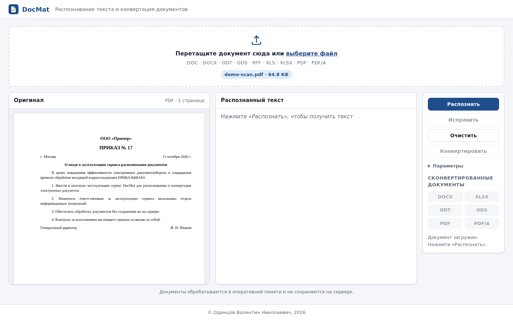
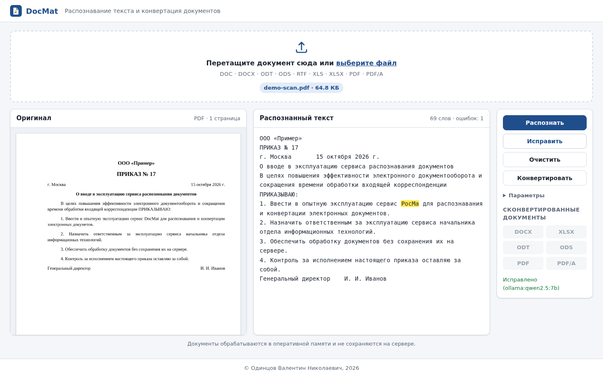
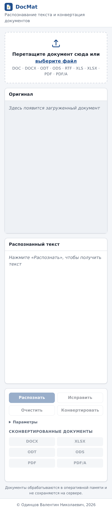

<div align="center">

**УТВЕРЖДАЮ**<br>
Правообладатель<br>
_____________ В. Н. Одинцов<br>
«___» ____________ 2026 г.

<br>

# ТЕХНИЧЕСКОЕ ЗАДАНИЕ

## на создание автоматизированной системы распознавания текста и конвертации документов «DocMat»

Шифр: DocMat-ТЗ-01<br>
Редакция 1.0

Листов: по факту

<br>

Разработано в соответствии с ГОСТ 34.602-2020<br>
«Информационные технологии. Комплекс стандартов на автоматизированные системы.<br>
Техническое задание на создание автоматизированной системы»

2026

</div>

---

## Содержание

1. [Общие сведения](#1-общие-сведения)
2. [Цели и назначение создания системы](#2-цели-и-назначение-создания-системы)
3. [Характеристика объекта автоматизации](#3-характеристика-объекта-автоматизации)
4. [Требования к системе](#4-требования-к-системе)
5. [Состав и содержание работ по созданию системы](#5-состав-и-содержание-работ-по-созданию-системы)
6. [Порядок разработки системы](#6-порядок-разработки-системы)
7. [Порядок контроля и приёмки системы](#7-порядок-контроля-и-приёмки-системы)
8. [Требования к подготовке объекта автоматизации к вводу системы в действие](#8-требования-к-подготовке-объекта-автоматизации-к-вводу-системы-в-действие)
9. [Требования к документированию](#9-требования-к-документированию)
10. [Источники разработки](#10-источники-разработки)

Приложение А. [Экранные формы пользовательского интерфейса](#приложение-а-экранные-формы-пользовательского-интерфейса)<br>
Приложение Б. [Программный интерфейс (API)](#приложение-б-программный-интерфейс-api)<br>
Приложение В. [Перечень сокращений](#приложение-в-перечень-сокращений)<br>
Приложение Г. [Результаты предварительных испытаний качества](#приложение-г-результаты-предварительных-испытаний-качества)

---

## 1. Общие сведения

### 1.1. Полное наименование системы и её условное обозначение

Полное наименование: **Автоматизированная система распознавания текста и конвертации документов**.

Условное обозначение: **DocMat** (далее — Система).

### 1.2. Шифр темы

DocMat-2026.

### 1.3. Наименование заказчика и разработчика

| Роль | Наименование |
|---|---|
| Заказчик и правообладатель | Одинцов Валентин Николаевич |
| Разработчик | Одинцов Валентин Николаевич |

### 1.4. Основания для разработки

Инициативная разработка правообладателя.

### 1.5. Плановые сроки начала и окончания работ

| Этап | Срок |
|---|---|
| Начало работ | октябрь 2026 г. |
| Опытный образец (версия 0.1) | октябрь 2026 г. |
| Опытная эксплуатация | ноябрь — декабрь 2026 г. |
| Ввод в постоянную эксплуатацию | по результатам опытной эксплуатации |

### 1.6. Источники и порядок финансирования

Собственные средства правообладателя.

### 1.7. Порядок оформления и предъявления результатов работ

Результаты работ предъявляются в виде:

- исходного кода Системы в репозитории проекта;
- Docker-образа и файла `docker-compose.yml` для развёртывания;
- комплекта документации по разделу 9 настоящего ТЗ.

Приёмка проводится по разделу 7.

### 1.8. Нормативные документы

- ГОСТ 34.602-2020. Техническое задание на создание автоматизированной системы.
- ГОСТ 34.601-90. Автоматизированные системы. Стадии создания.
- ГОСТ Р 59793-2021. Автоматизированные системы. Стадии создания.
- ГОСТ Р 59795-2021. Требования к содержанию документов.
- ГОСТ 19.101-77. ЕСПД. Виды программ и программных документов.
- ГОСТ Р ИСО 19005-2-2014. Формат файлов электронных документов для долгосрочного сохранения (PDF/A-2).
- ГОСТ Р ИСО/МЭК 26300-2010. Формат Open Document (ODF).
- Федеральный закон от 27.07.2006 № 152-ФЗ «О персональных данных».

---

## 2. Цели и назначение создания системы

### 2.1. Назначение системы

Система предназначена для:

- распознавания текста в электронных и отсканированных документах;
- проверки распознанного текста на орфографические ошибки и ошибки распознавания;
- автоматического и ручного исправления этих ошибок;
- конвертации результата в форматы DOCX, XLSX, ODT, ODS, PDF и PDF/A.

### 2.2. Цели создания системы

1. Сократить время перевода бумажных и отсканированных документов в редактируемый вид.
2. Повысить качество распознанного текста за счёт словарной проверки и исправления локальной языковой моделью.
3. Обеспечить конфиденциальность: документы обрабатываются **локально**, без передачи сторонним облачным сервисам и **без хранения на сервере**.
4. Обеспечить получение документа в формате долговременного хранения (PDF/A).
5. **Сохранить первоначальное форматирование** исходного документа во всех выходных форматах.

### 2.3. Критерии достижения целей

| Критерий | Целевое значение |
|---|---|
| Доля правильно распознанных слов в чистом скане 300 dpi на русском языке | не менее 97 % |
| Доля ошибочных слов (WER) после исправления Ollama на скане 150–200 dpi с шумом | не более 3 % |
| Время распознавания одной страницы A4 (CPU 4 ядра) | не более 10 с (до 30 с для сканов низкого качества) |
| Время исправления одной страницы Ollama | не более 60 с на CPU, не более 10 с на GPU |
| Сохранение оформления (п. 4.2.6) | все перечисленные элементы для каждого типа источника |
| Время конвертации в 6 форматов документа до 10 страниц | не более 30 с |
| Остаточные файлы пользователя на сервере после обработки | 0 |

---

## 3. Характеристика объекта автоматизации

### 3.1. Объект автоматизации

Объект автоматизации — процесс обработки входящих документов: перевод отсканированных и офисных документов в редактируемый текст, его вычитка и сохранение в нужном формате.

### 3.2. Существующее положение

Сейчас распознавание выполняется вручную или в разрозненных программах: отдельно OCR, отдельно проверка орфографии, отдельно конвертация. Облачные сервисы распознавания требуют передачи документов третьим лицам, что недопустимо для конфиденциальных и служебных документов.

### 3.3. Условия эксплуатации

Система эксплуатируется как веб-сервис в контейнере Docker на сервере или рабочей станции пользователя. Доступ осуществляется через веб-браузер в локальной сети. Подключение к интернету при работе не требуется (нужно только для первичной загрузки образов и языковой модели).

---

## 4. Требования к системе

### 4.1. Требования к системе в целом

#### 4.1.1. Требования к структуре и функционированию системы

Система состоит из следующих подсистем.

| № | Подсистема | Назначение | Реализация |
|---|---|---|---|
| 1 | Веб-интерфейс | Приём документа, отображение оригинала и результата, управление | HTML5, CSS3, JavaScript без внешних зависимостей |
| 2 | Приём и подготовка документов | Проверка формата, приведение к PDF, DOCX и XLSX, рендер страниц | Python, PyMuPDF, LibreOffice (headless) |
| 3 | Распознавание (OCR) | Оптическое распознавание с автоматической очисткой изображения низкого качества | Tesseract OCR 5 (rus, eng), NumPy, Pillow |
| 3а | Восстановление вёрстки | Построение редактируемого DOCX по текстовому слою PDF или результатам OCR: поля, абзацы, шрифты, выравнивание, отступы, табуляции, таблицы, изображения | PyMuPDF, python-docx (модуль `layout.py`) |
| 3б | Перенос правок | Перенос исправлений текста в базовый документ без потери оформления | python-docx, openpyxl (модуль `editable.py`) |
| 4 | Проверка орфографии | Поиск ошибок и вариантов исправления | Hunspell (через Enchant), словари ru_RU, en_US |
| 5 | Исправление текста | Исправление ошибок распознавания | Ollama (локальная LLM), резервно — Hunspell |
| 6 | Конвертация | Формирование выходных документов из базового документа | python-docx, openpyxl, LibreOffice |

Схема взаимодействия:

```
 Браузер пользователя                  Контейнер docmat                    Контейнер ollama
┌────────────────────┐  HTTP/JSON  ┌───────────────────────────┐  HTTP   ┌──────────────────┐
│ drag-and-drop      │────────────▶│ FastAPI (без состояния)   │────────▶│ LLM qwen2.5:7b   │
│ Оригинал │ Текст   │◀────────────│  ├─ PyMuPDF  (рендер, PDF)│         │ (локально)       │
│ Кнопки │ Ссылки    │             │  ├─ Tesseract (OCR)       │         └──────────────────┘
│ Blob-ссылки (RAM)  │             │  ├─ Hunspell (орфография) │
└────────────────────┘             │  └─ LibreOffice (конверт.)│
                                   │  tmpfs /tmp (только RAM)  │
                                   └───────────────────────────┘
```

Система не имеет состояния (stateless): каждый запрос содержит все необходимые данные, результаты возвращаются в ответе и на сервере не сохраняются.

**Базовый документ.** При распознавании Система строит редактируемый документ, повторяющий оформление исходного (DOCX для текстовых документов, PDF и сканов; XLSX для таблиц). Он возвращается в браузер вместе с текстом и присылается обратно при конвертации; на сервере он не хранится. Текст в правом блоке — это текст базового документа: абзацы разделены переводами строк, ячейки таблиц и табуляции — символами табуляции. При конвертации правки пользователя переносятся в базовый документ точечно, внутри исходных фрагментов текста, после чего из него формируются все выходные форматы.

#### 4.1.2. Требования к численности и квалификации персонала

- Пользователь — навыки работы с веб-браузером; специальная подготовка не требуется.
- Администратор — навыки работы с Docker и Docker Compose (запуск, обновление, просмотр журналов).

#### 4.1.3. Показатели назначения

| Показатель | Значение |
|---|---|
| Максимальный размер файла | 25 МБ (настраивается `DOCMAT_MAX_UPLOAD_MB`) |
| Максимальное число обрабатываемых страниц | 50 (настраивается `DOCMAT_MAX_PAGES`) |
| Разрешение OCR | 300 dpi (настраивается `DOCMAT_OCR_DPI`) |
| Языки распознавания | русский, английский, русский + английский |
| Одновременные пользователи | не менее 5 (2 рабочих процесса uvicorn) |

#### 4.1.4. Требования к надёжности

1. Ошибка обработки одного документа не должна влиять на других пользователей и на работоспособность сервиса.
2. Зависание LibreOffice прерывается по тайм-ауту (120 с по умолчанию); число одновременно запущенных экземпляров LibreOffice ограничено (3 на рабочий процесс), чтобы исключить исчерпание памяти.
3. При недоступности Ollama функция «Исправить» выполняется словарным методом с уведомлением пользователя.
4. Контейнер автоматически перезапускается при сбое (`restart: unless-stopped`) и имеет проверку состояния (`HEALTHCHECK`, `/api/health`).

#### 4.1.5. Требования к безопасности

1. Контейнер запускается от непривилегированного пользователя (UID 10001).
2. Корневая файловая система контейнера доступна только для чтения.
3. Проверяется сигнатура файла: файл, содержимое которого не соответствует расширению, отклоняется.
4. Имена выходных файлов очищаются от служебных символов и путей.
5. Ответы API содержат заголовки `Cache-Control: no-store`, `X-Content-Type-Options: nosniff`, `Referrer-Policy: no-referrer`.

#### 4.1.6. Требования к эргономике и технической эстетике

1. Интерфейс на русском языке.
2. Адаптивная вёрстка: корректное отображение на экранах от 360 до 2560 пикселей по ширине.
3. Длительные операции сопровождаются индикатором выполнения на кнопке и сообщением в строке состояния.
4. Недоступные действия отображаются неактивными (например, «Конвертировать» до появления текста).
5. Управление с клавиатуры: поле загрузки открывается по Enter или Пробелу, меню вариантов закрывается по Esc.

#### 4.1.7. Требования к эксплуатации и техническому обслуживанию

Обновление выполняется пересборкой и перезапуском контейнера (`docker compose up -d --build`). Регламентные работы по очистке данных не требуются, поскольку данные не хранятся.

#### 4.1.8. Требования к защите информации от несанкционированного доступа

**Документы, переданные в форму drag-and-drop и распознанные Системой, не должны храниться на сервере.** Требование обеспечивается следующими мерами.

| № | Мера | Реализация |
|---|---|---|
| 1 | Обработка в оперативной памяти | Файл читается в память процесса; PDF, изображения и текст передаются между модулями как байтовые объекты |
| 2 | Временные файлы только в RAM | Для LibreOffice создаётся временный каталог в `/dev/shm` или в tmpfs `/tmp` и удаляется сразу после операции, в том числе при ошибке |
| 3 | Отсутствие состояния на сервере | Нет базы данных, кэша документов и сессий; базовый документ и результаты конвертации возвращаются в ответе (base64) и хранятся только в браузере |
| 4 | Скачивание без сервера | Ссылки на сконвертированные файлы — Blob-URL в памяти браузера; при нажатии «Очистить» они освобождаются |
| 5 | Отсутствие содержимого в журналах | В журнал пишется только число страниц; имена и содержимое документов не записываются, журнал доступа отключён |
| 6 | Запрет кэширования | `Cache-Control: no-store` для всех ответов API |
| 7 | Защита от записи | `read_only: true` для файловой системы контейнера |
| 8 | Отсутствие внешних сервисов | OCR, проверка орфографии и LLM работают локально |

Требование проверяется автоматическим тестом `test_nothing_left_in_tmp_dir`.

#### 4.1.9. Требования к сохранности информации при авариях

Система не хранит пользовательские данные, поэтому при аварии теряется только результат текущей операции. Пользователь повторяет её после восстановления. Языковые модели Ollama хранятся в томе `ollama-models` и сохраняются при перезапуске.

#### 4.1.10. Требования к патентной чистоте

Используются только компоненты со свободными лицензиями:

| Компонент | Лицензия |
|---|---|
| Python, FastAPI, Uvicorn | PSF, MIT, BSD |
| Tesseract OCR | Apache 2.0 |
| LibreOffice | MPL 2.0 |
| Hunspell, Enchant | LGPL/MPL |
| PyMuPDF | AGPL 3.0 (для закрытого коммерческого распространения нужна коммерческая лицензия Artifex) |
| python-docx, openpyxl | MIT |
| Ollama | MIT; лицензия модели — по выбранной модели (Qwen2.5 — Apache 2.0) |

#### 4.1.11. Требования к стандартизации и унификации

- Выходные форматы соответствуют стандартам: OOXML (ISO/IEC 29500) для DOCX и XLSX, ODF (ГОСТ Р ИСО/МЭК 26300) для ODT и ODS, PDF/A-2b (ГОСТ Р ИСО 19005-2).
- API описывается спецификацией OpenAPI 3, которая доступна по адресу `/api/docs`.

### 4.2. Требования к функциям, выполняемым системой

#### 4.2.1. Приём документа (поле drag-and-drop)

| № | Требование |
|---|---|
| Ф-1.1 | В верхней части главной страницы расположено поле drag-and-drop для перетаскивания документа |
| Ф-1.2 | Поле принимает файлы форматов **DOC, DOCX, ODT, ODS, RTF, XLS, XLSX, PDF, PDF/A** |
| Ф-1.3 | Нажатие на поле открывает стандартный диалог выбора файла |
| Ф-1.4 | При наведении файла поле визуально подсвечивается |
| Ф-1.5 | Файл неподдерживаемого формата отклоняется с сообщением об ошибке |
| Ф-1.6 | После загрузки в поле отображаются имя и размер файла |
| Ф-1.7 | Формат PDF/A определяется автоматически по метаданным XMP (`pdfaid:part`) и указывается в заголовке блока «Оригинал» |

#### 4.2.2. Блок «Оригинал» (левый)

| № | Требование |
|---|---|
| Ф-2.1 | Под полем drag-and-drop слева расположен блок, отображающий загруженный документ в исходном виде (постранично, как изображения) |
| Ф-2.2 | Офисные документы предварительно преобразуются в PDF средствами LibreOffice |
| Ф-2.3 | В заголовке блока указываются формат и число страниц |
| Ф-2.4 | Если страниц больше предельного числа, выводится соответствующее уведомление |

#### 4.2.3. Блок «Распознанный текст» (правый)

| № | Требование |
|---|---|
| Ф-3.1 | Справа от блока «Оригинал» расположен блок с распознанным текстом |
| Ф-3.2 | **Слова с ошибками выделяются жёлтым цветом** |
| Ф-3.3 | Нажатие на выделенное слово открывает меню вариантов исправления и пункт «Пропустить слово» |
| Ф-3.4 | Текст доступен для ручного редактирования; после правки проверка повторяется автоматически (через 0,9 с) |
| Ф-3.5 | В заголовке блока отображаются число слов и число ошибок |
| Ф-3.6 | Ошибкой считаются: слово, отсутствующее в словарях ru_RU и en_US, а также слово со смешением кириллицы и латиницы («Пpивeт»). Аббревиатуры (до 5 прописных букв) и однобуквенные слова не проверяются |

#### 4.2.4. Блок управления

Рядом с правым блоком расположен блок кнопок управления и ссылок на сконвертированные документы.

| № | Кнопка / элемент | Действие |
|---|---|---|
| Ф-4.1 | **Распознать** | Строит базовый документ (п. 4.1.1) и выводит его текст. DOCX используется как есть; DOC, ODT, RTF переводятся в DOCX; XLSX используется как есть; XLS, ODS переводятся в XLSX (ячейки разделяются табуляцией, листы — пустой строкой). Для PDF вёрстка каждой страницы восстанавливается по текстовому слою, а при его отсутствии (скан) — по результатам OCR Tesseract. Если в офисном документе текста нет (например, вставлен скан), он распознаётся как PDF. Режим «Только OCR» принудительно включает OCR |
| Ф-4.1.1 | Очистка скана | Если менее 85 % распознанных слов найдено в словаре, изображение дополнительно распознаётся после шумоподавления (медианный фильтр, размытие с бинаризацией по Оцу); выбирается вариант с наибольшим числом словарных слов |
| Ф-4.2 | **Исправить** | Исправляет ошибки текста с помощью локальной LLM через Ollama; длинный текст обрабатывается фрагментами до 2500 символов по границам абзацев. При недоступности Ollama выполняет словарное исправление и уведомляет пользователя. Ответ LLM, изменивший объём фрагмента более чем на 20–25 %, отбрасывается в пользу словарного исправления. Правки модели, меняющие переводы строк и табуляции (элементы вёрстки), отменяются; исправления слов рядом с ними сохраняются |
| Ф-4.2.1 | Словарное исправление | Заменяет слово, только если вариант надёжен: расстояние Дамерау — Левенштейна не более 1 для слов до 5 букв и не более 2 для более длинных; слово не содержит заглавных букв в середине (названия, искажённая латиница); вариант не разбивает слово на два. Слова со смешением алфавитов исправляются заменой латинских букв на кириллические. Остальные ошибки остаются выделенными для ручного исправления |
| Ф-4.3 | **Очистить** | Удаляет из интерфейса документ, текст и ссылки, освобождает память браузера |
| Ф-4.4 | **Конвертировать** | Переносит текущий (в том числе исправленный вручную) текст в базовый документ и формирует из него DOCX, XLSX, ODT, ODS, PDF, PDF/A с сохранением оформления (п. 4.2.6). Правки, которые нельзя перенести без нарушения структуры (объединение или разбиение абзацев, удаление табуляции), не применяются, и пользователь получает сообщение об их числе |
| Ф-4.5 | Ссылки **DOCX, XLSX, ODT, ODS, PDF, PDF/A** | Неактивны до конвертации, после неё скачивают соответствующий файл. Любое изменение текста делает ссылки неактивными |
| Ф-4.6 | Параметры | Язык распознавания (рус + англ / рус / англ), режим «Только OCR» |
| Ф-4.7 | Строка состояния | Ход операции, результат, ошибки |

#### 4.2.5. Правила формирования выходных документов

| Базовый документ | DOCX | ODT | PDF, PDF/A-2b | XLSX | ODS |
|---|---|---|---|---|---|
| DOCX | базовый с правками | LibreOffice из DOCX | LibreOffice из DOCX | абзацы — строки колонки A, таблицы — диапазоны ячеек; начертание, кегль, выравнивание сохраняются | LibreOffice из XLSX |
| XLSX | LibreOffice: XLSX → HTML → DOCX (таблица с заливкой, начертанием, объединёнными ячейками) | LibreOffice из DOCX | LibreOffice Calc из XLSX | базовый с правками, формулы пересчитываются | LibreOffice из XLSX |

Имя выходного файла совпадает с именем исходного, для PDF/A используется суффикс `.pdfa.pdf`.

#### 4.2.6. Требования к сохранению форматирования

**Сконвертированные документы должны сохранять первоначальное форматирование исходных документов.**

| Источник | Сохраняется |
|---|---|
| DOCX | Всё оформление: стили, шрифты, кегль, начертание, цвет, абзацы, списки, таблицы, колонтитулы, изображения, поля и размер страницы. Правки меняют только текст внутри исходных фрагментов |
| DOC, ODT, RTF | То же после конвертации в DOCX средствами LibreOffice (возможны отличия в редких элементах, которые LibreOffice не переносит в DOCX) |
| XLSX, XLS, ODS | Листы, ячейки, форматы чисел, шрифты, заливка, границы, объединённые ячейки, ширина столбцов, формулы (пересчитываются после правок). Изменить можно текстовые и числовые ячейки; ячейки с формулами не редактируются |
| PDF с текстовым слоем | Размер страницы и поля; абзацы и их выравнивание (по левому краю, по центру, по правому краю, по ширине); отступы слева и первой строки; межстрочный интервал; шрифт, кегль, начертание и цвет каждого фрагмента; табуляции («г. Москва … дата»); таблицы; изображения (логотипы, печати, подписи) |
| Скан (PDF без текстового слоя) | Размер страницы и поля; абзацы, выравнивание, отступы, межстрочный интервал, табуляции; кегль (по высоте строчных и прописных букв) и полужирное начертание (по плотности штрихов). Шрифт — Times New Roman |

Ограничения:

- В сканах не восстанавливаются изображения (печати, подписи, логотипы), таблицы и курсив; многоколоночная вёрстка передаётся строками с табуляцией.
- Перенос строк внутри абзаца может отличаться от оригинала, если подставленный шрифт отличается метриками.
- Объединение или разбиение абзацев в правом блоке не переносится в документ (п. Ф-4.4).

#### 4.2.7. Сведения о правообладателе

| № | Требование |
|---|---|
| Ф-5.1 | В нижней части экрана расположена надпись: **«© Одинцов Валентин Николаевич, 2026»** |

### 4.3. Требования к видам обеспечения

#### 4.3.1. Программное обеспечение

| Компонент | Версия |
|---|---|
| Язык программирования | Python 3.11+ |
| Веб-фреймворк | FastAPI 0.162, Uvicorn 0.54 |
| Обработка PDF | PyMuPDF 2.0 |
| Обработка изображений | NumPy 2.4, Pillow 13 |
| OCR | Tesseract 5 (pytesseract 0.3.13), языковые пакеты rus, eng |
| Офисный пакет | LibreOffice 7.4+ (headless) |
| Орфография | pyenchant 3.3, словари hunspell-ru, hunspell-en-us |
| Генерация документов | python-docx 1.2, openpyxl 3.1 |
| LLM | Ollama, модель по умолчанию `qwen2.5:7b` (настраивается `OLLAMA_MODEL`) |
| Контейнеризация | Docker 24+, Docker Compose v2 |
| Браузеры | Chrome/Chromium 120+, Firefox 136+, Safari 17+, Яндекс Браузер, Edge |

#### 4.3.2. Техническое обеспечение

| Параметр | Минимум | Рекомендуется |
|---|---|---|
| Процессор | 4 ядра x86-64 или ARM64 | 8 ядер |
| ОЗУ | 8 ГБ (с моделью 7B) | 16 ГБ |
| Диск | 15 ГБ (образы и модель) | 30 ГБ SSD |
| GPU | не требуется | NVIDIA с 8 ГБ видеопамяти для ускорения Ollama |
| ОС хоста | любая с Docker: Linux (в т. ч. РЕД ОС, Astra Linux, ALT), Windows 10/11, macOS | |

#### 4.3.3. Информационное обеспечение

Система не использует базу данных. Справочные данные — словари Hunspell и языковые модели Tesseract — входят в состав образа.

#### 4.3.4. Лингвистическое обеспечение

Интерфейс и сообщения на русском языке. Распознавание и проверка орфографии выполняются для русского и английского языков.

---

## 5. Состав и содержание работ по созданию системы

| № | Этап | Содержание работ | Результат | Срок |
|---|---|---|---|---|
| 1 | Формирование требований | Анализ задачи, выбор технологий | Настоящее ТЗ | октябрь 2026 |
| 2 | Технический проект | Архитектура, API, макеты интерфейса | Структура проекта, Приложения А и Б | октябрь 2026 |
| 3 | Рабочая документация и разработка | Программирование подсистем 1–6, автотесты | Исходный код, Dockerfile, тесты | октябрь — ноябрь 2026 |
| 4 | Предварительные испытания | Автотесты, проверка на тестовых документах | Протокол испытаний | ноябрь 2026 |
| 5 | Опытная эксплуатация | Работа на реальных документах, сбор замечаний | Журнал замечаний | ноябрь — декабрь 2026 |
| 6 | Приёмочные испытания и ввод в действие | Проверка по разделу 7 | Акт приёмки | по итогам этапа 5 |

---

## 6. Порядок разработки системы

1. Исходный код ведётся в системе контроля версий Git.
2. Каждое изменение сопровождается автотестами (`pytest`); перед сборкой образа все тесты должны проходить.
3. Структура проекта:

```
DocMat/
├── app/
│   ├── main.py              # HTTP API и раздача интерфейса
│   ├── config.py            # настройки из переменных окружения
│   ├── services/
│   │   ├── documents.py     # проверка формата, приведение к PDF, рендер
│   │   ├── recognizer.py    # построение базового документа
│   │   ├── layout.py        # восстановление вёрстки PDF и сканов, OCR
│   │   ├── editable.py      # текст базового документа и перенос правок
│   │   ├── spellcheck.py    # Hunspell, поиск ошибок
│   │   ├── corrector.py     # Ollama + резервное исправление
│   │   ├── converter.py     # DOCX, XLSX, ODT, ODS, PDF, PDF/A
│   │   ├── office.py        # вызов LibreOffice
│   │   └── storage.py       # эфемерные каталоги в RAM
│   └── static/              # index.html, css, js
├── tests/                   # автотесты
├── docs/                    # ТЗ, руководства, скриншоты, демонстрационные файлы
├── scripts/                 # демо-скан, скриншоты, оценка качества (eval_correction.py)
├── Dockerfile
├── docker-compose.yml
├── requirements.txt
└── requirements-dev.txt
```

---

## 7. Порядок контроля и приёмки системы

### 7.1. Виды испытаний

Предварительные испытания (автоматические и ручные), опытная эксплуатация, приёмочные испытания.

### 7.2. Программа испытаний

| № | Проверка | Метод | Критерий успеха |
|---|---|---|---|
| И-1 | Загрузка каждого из форматов DOC, DOCX, ODT, ODS, RTF, XLS, XLSX, PDF, PDF/A | Ручной | Документ отображается в блоке «Оригинал», PDF/A определяется |
| И-2 | Отклонение неподдерживаемого и подменённого файла | Автотест | Код 415, сообщение пользователю |
| И-3 | Распознавание PDF с текстовым слоем; извлечение текста из DOCX и таблиц XLSX | Автотест | Текст совпадает с исходным, абзацы и ячейки сохранены |
| И-4 | Распознавание скана (OCR), в том числе низкого качества | Автотест + `scripts/eval_correction.py` | Критерии п. 2.3 |
| И-5 | Подсветка ошибок жёлтым цветом | Автотест + ручной | Ошибочные слова выделены, правильные нет |
| И-6 | Исправление через Ollama и резервное исправление | Автотест + `scripts/eval_correction.py` | Ошибки исправлены, смысл текста и вёрстка не изменены, правки перенесены в документ полностью |
| И-7 | Конвертация в 6 форматов | Автотест | Все файлы открываются; PDF/A содержит `pdfaid:part` и проходит валидатор veraPDF |
| И-8 | Отсутствие документов на сервере | Автотест + ручной | После обработки нет файлов `docmat-*` во временных каталогах; журналы не содержат имён и текста документов |
| И-9 | Кнопка «Очистить» | Ручной | Интерфейс возвращается в исходное состояние |
| И-10 | Надпись о правообладателе | Автотест | Внизу страницы: «© Одинцов Валентин Николаевич, 2026» |
| И-11 | Запуск в Docker на Linux, Windows, macOS | Ручной | `docker compose up` поднимает сервис, `/api/health` отвечает |
| И-12 | Адаптивность | Ручной | Корректная вёрстка при ширине 390 и 1440 пикселей |
| И-13 | Сохранение форматирования | Автотест + ручной | Для каждого типа источника выходные документы сохраняют элементы оформления по п. 4.2.6; правки текста не нарушают оформление |

Автотесты запускаются командой `.venv/bin/pytest`.

### 7.3. Приёмка

Система считается принятой при успешном прохождении проверок И-1 — И-13 и подписании акта приёмки.

---

## 8. Требования к подготовке объекта автоматизации к вводу системы в действие

1. Установить Docker и Docker Compose на сервер.
2. Выполнить `docker compose up -d --build`.
3. Загрузить языковую модель: `docker compose run --rm ollama-pull`.
4. Проверить состояние: `curl http://<сервер>:8000/api/health`.
5. При доступе из сети предприятия разместить Систему за обратным прокси с HTTPS и, при необходимости, с аутентификацией.
6. Ознакомить пользователей с руководством пользователя.

---

## 9. Требования к документированию

| № | Документ | Основание |
|---|---|---|
| 1 | Техническое задание (настоящий документ) | ГОСТ 34.602-2020 |
| 2 | Пояснительная записка к техническому проекту | ГОСТ Р 59795-2021 |
| 3 | Руководство пользователя | ГОСТ Р 59795-2021 |
| 4 | Руководство администратора (установка и обновление) | ГОСТ Р 59795-2021 |
| 5 | Описание программного интерфейса (OpenAPI, `/api/docs`) | — |
| 6 | Программа и методика испытаний | ГОСТ 34.603-92 |

Документы оформляются в электронном виде на русском языке.

---

## 10. Источники разработки

1. ГОСТ 34.602-2020, ГОСТ 34.601-90, ГОСТ Р 59793-2021, ГОСТ Р 59795-2021.
2. Документация Tesseract OCR — https://tesseract-ocr.github.io/
3. Документация Ollama — https://github.com/ollama/ollama/tree/main/docs
4. Документация LibreOffice: фильтры экспорта, параметры командной строки.
5. Документация FastAPI — https://fastapi.tiangolo.com/
6. Документация PyMuPDF — https://pymupdf.readthedocs.io/
7. ГОСТ Р ИСО 19005-2-2014 (PDF/A-2).

---

## Приложение А. Экранные формы пользовательского интерфейса

Скриншоты сняты с работающего опытного образца версии 0.1 на демонстрационном документе `docs/samples/demo-scan.pdf`. Это скан без текстового слоя, в который намеренно внесены опечатки.

### А.1. Главная страница (исходное состояние)

Поле drag-and-drop вверху, под ним блоки «Оригинал» и «Распознанный текст», справа блок управления. Внизу надпись о правообладателе.


### А.2. Поле drag-and-drop при перетаскивании файла


### А.3. Документ загружен

Левый блок показывает оригинал, в поле указаны имя и размер файла.



### А.4. Результат распознавания с выделением ошибок

Слова с ошибками выделены жёлтым цветом: опечатки исходного документа («распознования», «докуметов», «информационых») и ошибка OCR («РосМа» вместо «DocMat»).


### А.5. Меню вариантов исправления

Открывается нажатием на выделенное слово.


### А.6. После нажатия «Исправить»

Исправление выполнено локальной моделью `qwen2.5:7b` через Ollama: опечатки оригинала («распознования», «докуметов», «информационых») и мусор распознавания исправлены, табуляции «г. Москва → дата» сохранены. Название «DocMat», искажённое OCR в «РосМа», модель восстановить не смогла: оно остаётся выделенным для ручной правки.



### А.7. После конвертации

Ссылки DOCX, XLSX, ODT, ODS, PDF, PDF/A активны.


### А.8. Мобильная версия (ширина 390 пикселей)



### А.9. Сохранение форматирования

Слева исходный скан, справа PDF/A, полученный после распознавания, исправления и конвертации. Сохранены заголовки, кегль и полужирное начертание, выравнивание по центру и по ширине, отступы первой строки, табуляция с выравниванием даты и подписи по правому краю. Опечатки оригинала исправлены.


---

## Приложение Б. Программный интерфейс (API)

| Метод | Адрес | Вход | Выход |
|---|---|---|---|
| GET | `/` | — | Главная страница |
| GET | `/api/health` | — | Состояние Tesseract, LibreOffice, словарей, Ollama; лимиты |
| POST | `/api/preview` | `multipart`: `file` | `filename`, `format`, `page_count`, `pages[]` (PNG data URI), `truncated` |
| POST | `/api/recognize` | `multipart`: `file`, `lang`, `force_ocr` | `text`, `errors[]`, `pages[]` (`page`, `method`: `document` — офисный документ, `text` — текстовый слой PDF, `ocr` — Tesseract), `base` (`kind`: `docx` / `xlsx`, `data`: base64) |
| POST | `/api/check` | JSON: `text` | `errors[]` |
| POST | `/api/correct` | JSON: `text` | `text`, `errors[]`, `engine`, `warning` |
| POST | `/api/convert` | `multipart`: `base` (файл базового документа), `kind`, `text` (файл UTF-8), `filename` | `files[]`: `format`, `label`, `filename`, `mime`, `data` (base64); `applied`, `skipped` — число перенесённых и неперенесённых правок |
| GET | `/api/docs` | — | Интерактивная спецификация OpenAPI |

Элемент `errors[]`: `start`, `end` (смещения в единицах UTF-16), `word`, `suggestions[]`.

Коды ошибок: 400 — пустой файл или текст; 413 — превышен размер; 415 — неподдерживаемый или повреждённый файл; 422 — некорректные параметры; 500 — ошибка конвертации.

### Переменные окружения

| Переменная | По умолчанию | Назначение |
|---|---|---|
| `DOCMAT_MAX_UPLOAD_MB` | 25 | Максимальный размер файла |
| `DOCMAT_MAX_PAGES` | 50 | Максимальное число страниц |
| `DOCMAT_PREVIEW_DPI` | 110 | Разрешение предпросмотра |
| `DOCMAT_OCR_DPI` | 300 | Разрешение OCR |
| `DOCMAT_SPELL_LANGS` | ru_RU,en_US | Словари проверки орфографии |
| `DOCMAT_TMP_DIR` | /dev/shm | Каталог временных файлов (должен находиться в RAM) |
| `DOCMAT_SOFFICE_TIMEOUT` | 120 | Тайм-аут LibreOffice, с |
| `DOCMAT_SOFFICE_CONCURRENCY` | 3 | Число одновременных экземпляров LibreOffice на рабочий процесс |
| `OLLAMA_URL` | http://localhost:11434 | Адрес Ollama |
| `OLLAMA_MODEL` | qwen2.5:7b | Модель для исправления текста |
| `OLLAMA_TIMEOUT` | 180 | Тайм-аут запроса к Ollama, с |

---

## Приложение В. Перечень сокращений

| Сокращение | Расшифровка |
|---|---|
| АС | Автоматизированная система |
| ТЗ | Техническое задание |
| OCR | Optical Character Recognition — оптическое распознавание символов |
| LLM | Large Language Model — большая языковая модель |
| API | Application Programming Interface — программный интерфейс |
| PDF/A | Формат PDF для долговременного хранения (ГОСТ Р ИСО 19005) |
| ODF | Open Document Format (ODT, ODS) |
| OOXML | Office Open XML (DOCX, XLSX) |
| RAM | Оперативная память |
| tmpfs | Файловая система в оперативной памяти |
| WER | Word Error Rate — доля ошибочных слов относительно эталона |

---

## Приложение Г. Результаты предварительных испытаний качества

Испытания проведены 30.10.2026 скриптом `scripts/eval_correction.py`: демонстрационный документ (Приложение А) переведён в сканы разного качества, распознан и исправлен. Оборудование: CPU x86-64 без GPU; модель `qwen2.5:7b`.

| Скан | WER после OCR | WER после словаря | WER после Ollama | OCR, с | Ollama, с |
|---|---|---|---|---|---|
| Хороший: 300 dpi | 1,3 % | 1,3 % | 1,3 % | 1,6 | 38,6 |
| Средний: 200 dpi, наклон 0,8°, шум, JPEG 60 | 1,3 % | 1,3 % | 1,3 % | 3,0 | 36,0 |
| Плохой: 150 dpi, наклон 1,5°, сильный шум, JPEG 35, размытие | 2,6 % | 2,6 % | **0,0 %** | 2,4 | 36,5 |
| Очень плохой: 110 dpi, наклон 2°, сильный шум, JPEG 25, размытие | 28,9 % | 17,1 % | **2,6 %** | 22,6 | 36,3 |
| Опечатки в самом документе (3 слова), скан среднего качества | 5,3 % | 1,3 % | 1,3 % | 3,0 | 36,9 |

Выводы:

1. На сканах 150–300 dpi Tesseract почти безошибочен; оставшаяся ошибка 1,3 % — название «DocMat», которое OCR читает как «РосМа», а исправить его не могут ни словарь, ни модель.
2. Очистка изображения (п. Ф-4.1.1) снизила WER очень плохого скана после OCR с 97 % до 29 %, а исправление Ollama — до 2,6 %.
3. Ollama исправляет как ошибки распознавания, так и опечатки оригинала; словарь надёжно исправляет только простые опечатки.
4. Во всех испытаниях правки модели полностью перенесены в базовый документ, вёрстка не нарушена.
5. Время исправления на CPU — 35–40 с на страницу; для потока документов рекомендуется GPU (п. 4.3.2).

---

<div align="center">© Одинцов Валентин Николаевич, 2026</div>
