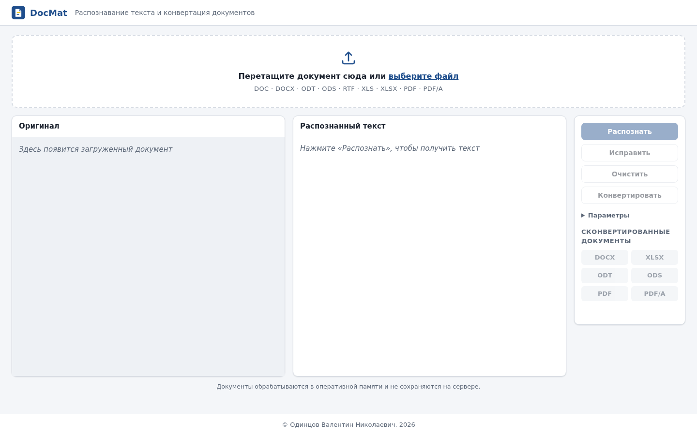
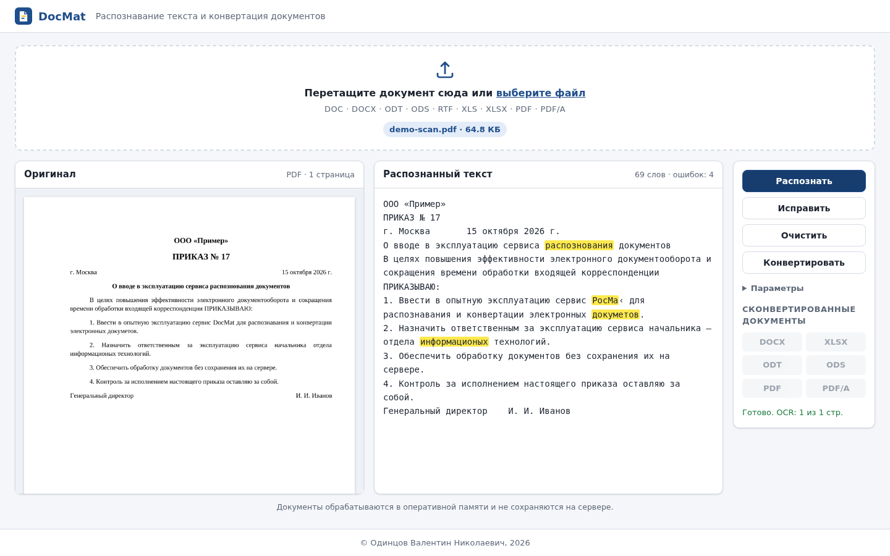
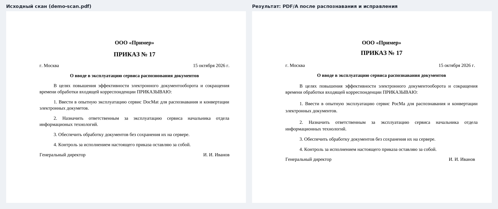
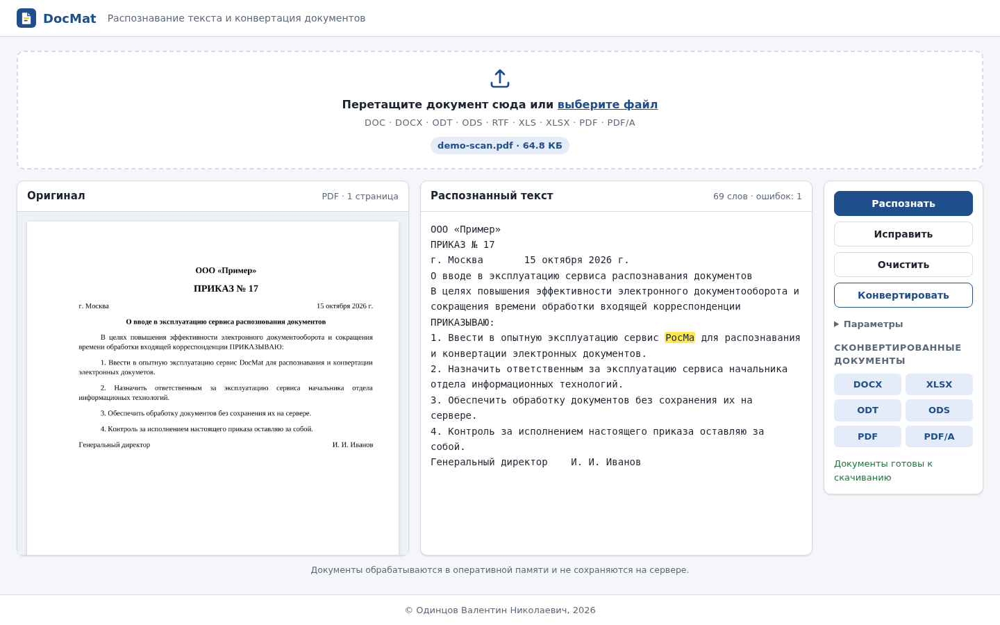

# DocMat. Руководство пользователя

Редакция 1.0, 2026

## 1. Назначение

DocMat распознаёт текст в документах и сканах, находит в нём ошибки, помогает их исправить и сохраняет результат в форматах DOCX, XLSX, ODT, ODS, PDF и PDF/A.

Ваши документы не сохраняются на сервере. Они существуют только во время обработки и в окне вашего браузера до нажатия «Очистить» или закрытия вкладки.

## 2. Начало работы

Откройте в браузере адрес, который сообщил администратор (например, `http://docmat.local:8000`).

Экран состоит из пяти частей:

1. **Поле загрузки** вверху.
2. **Оригинал** слева: загруженный документ в исходном виде.
3. **Распознанный текст** в центре.
4. **Блок управления** справа: кнопки и ссылки на готовые файлы.
5. **Строка о правообладателе** внизу.

## 3. Загрузка документа

Перетащите файл в поле загрузки или нажмите на поле и выберите файл.

Поддерживаются форматы DOC, DOCX, ODT, ODS, RTF, XLS, XLSX, PDF и PDF/A. Размер файла — до 25 МБ, обрабатываются первые 50 страниц (лимиты может изменить администратор).

После загрузки документ появится в блоке «Оригинал», а над ним будут указаны формат и число страниц.

## 4. Распознавание

Нажмите **«Распознать»**.

- Из документов Word, LibreOffice и RTF текст берётся напрямую, без потерь.
- Из таблиц Excel и LibreOffice текст берётся построчно, ячейки разделяются табуляцией.
- Для PDF используется встроенный текст, а отсканированные страницы распознаются. Сканы низкого качества автоматически очищаются от шума, поэтому их распознавание занимает больше времени.

В правом блоке каждая строка — это абзац исходного документа, а широкий пробел — табуляция или граница ячейки таблицы. Это нужно, чтобы при конвертации сохранить оформление.

Строка состояния подскажет, какой способ был использован.

**Параметры** (раскрываются под кнопками):

- **Язык распознавания.** Если документ только на русском, выбор «Русский» немного повышает точность.
- **Только OCR.** Включите, если встроенный текст PDF искажён (например, «кракозябры») и документ нужно распознать по изображению.

## 5. Проверка и исправление ошибок

Слова с возможными ошибками **выделены жёлтым**. Число ошибок указано над текстом.

Ошибки можно исправить тремя способами:

1. **Вручную.** Щёлкните в текст и исправьте его как в обычном редакторе. Проверка обновится сама.
2. **Выбором варианта.** Щёлкните по выделенному слову и выберите правильный вариант. Если слово написано верно (фамилия, термин), выберите «Пропустить слово».

   

3. **Кнопкой «Исправить».** Весь текст исправит локальная языковая модель. На сервере без видеокарты это занимает до минуты на страницу. Если модель недоступна, сработает словарное исправление: оно меняет только слова, в которых уверено, а остальные оставляет выделенными.

Выделение не всегда означает ошибку: в словаре может не быть редких фамилий, названий и терминов.

## 6. Конвертация и скачивание

Нажмите **«Конвертировать»**. Ссылки DOCX, XLSX, ODT, ODS, PDF и PDF/A станут активными. Нажмите нужную ссылку, чтобы скачать файл.

**Оформление сохраняется.** Ваши исправления вносятся в документ, который повторяет исходный: шрифты, размеры, жирный шрифт, выравнивание, отступы, таблицы. Для документов Word и таблиц Excel сохраняется всё оформление. Для сканов восстанавливаются поля, абзацы, выравнивание, отступы, размер шрифта и жирный шрифт; печати, подписи и таблицы со сканов не переносятся.

Чтобы оформление не нарушилось, не объединяйте и не разбивайте абзацы в правом блоке (не удаляйте и не добавляйте переводы строк). Такие правки не переносятся в документ, и после конвертации появится сообщение об их числе.

- **PDF/A** подходит для архивного хранения и передачи в системы электронного документооборота.
- **XLSX и ODS** из таблицы сохраняют листы, ячейки, формулы и оформление. Из текстового документа абзацы становятся строками листа, а таблицы — ячейками.

Если вы изменили текст после конвертации, ссылки снова станут неактивными: нажмите «Конвертировать» ещё раз.

## 7. Завершение работы

Нажмите **«Очистить»**, чтобы убрать документ и результаты из окна браузера. Закрытие вкладки действует так же.

## 8. Сообщения об ошибках

| Сообщение | Что делать |
|---|---|
| Неподдерживаемый формат файла | Сохраните документ в одном из поддерживаемых форматов |
| Содержимое файла не соответствует его расширению | Файл переименован или повреждён: откройте его в редакторе и сохраните заново |
| Файл больше 25 МБ | Разделите документ на части или сожмите сканы |
| Документ защищён паролем | Снимите пароль в программе, где документ был создан |
| Текст не найден | Включите «Только OCR» и повторите распознавание |
| Ollama недоступна — выполнено словарное исправление | Языковая модель не запущена; сообщите администратору. Остальные функции работают |

---

© Одинцов Валентин Николаевич, 2026
